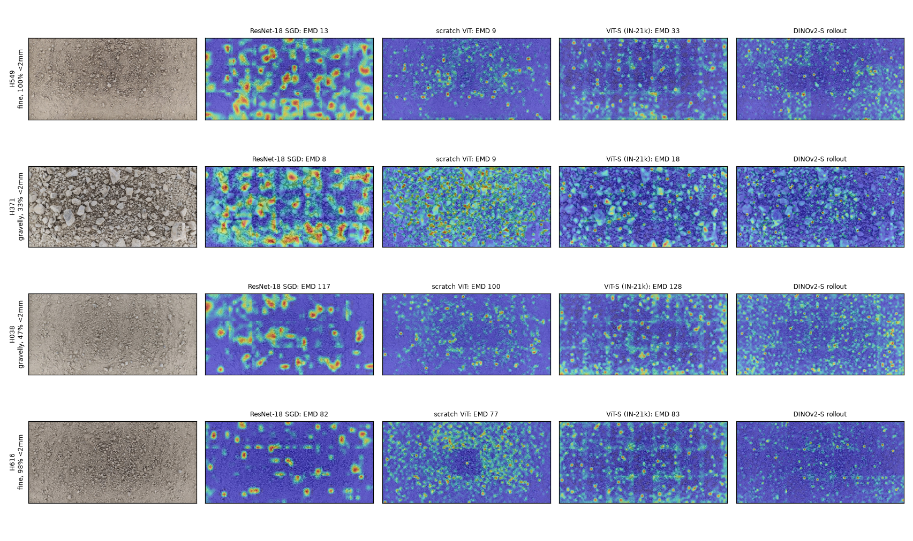
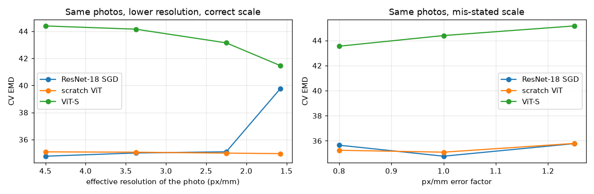

# Soil grain-size distribution from photos — CNNs, ViTs and self-supervised models

AI401 Advanced Computer Vision, Assignment #1. Kaggle competition *Predicting Soil Grain Size Distributions
from Images* (`soil-grain-size-from-photos`): from smartphone photos of a soil tray (+ its px/mm) predict the
cumulative % of mass passing 11 sieves (0.002–200 mm).

**Headline (site-grouped 5-fold CV, competition EMD, lower is better; mean-curve baseline 93.4):**

| | CV | 3-seed mean |
|---|---|---|
| ResNet-18, SGD (best CNN) | 37.9 ± 15.1 | 37.9 ± 0.3 |
| own ViT trained from scratch (best ViT) | 36.4 ± 14.7 | 37.4 ± 0.7 |
| MAE-B, LP-FT (best SSL tuning) | 41.0 ± 15.3 | — |
| DINOv2-S frozen, 100 mm crops + ridge (best frozen SSL) | 42.3 ± 15.9 | — |
| hand-crafted mm-indexed texture + ridge | 38.2 ± 14.6 | — |
| **final: diverse 4-model ensemble + extrapolation guard** | **36.39 ± 15.5** | |

The ± is the std over the 5 site folds (fold difficulty), not noise: seed-to-seed std is 0.2–0.7, so
differences under ~2 EMD between configurations are not effects. Leaderboard scores: [results table](reports/results_table.md).

Every hypothesis was committed before its experiments; predictions, results and the explanation of every
wrong prediction are in **[HYPOTHESES.md](HYPOTHESES.md)** (`git log -p HYPOTHESES.md` shows the order).

---

## Contents
1. [Reproducing](#reproducing) · 2. [Repository](#repository) · 3. [Part 0 — data, metric, validation, pipeline](#part-0--data-metric-validation-pipeline)
4. [Part 1 — CNN](#part-1--cnn) · 5. [Part 2 — ViT](#part-2--vit) · 6. [Part 3 — self-supervised](#part-3--self-supervised-encoders)
7. [Part 4 — interpretation](#part-4--interpretation-and-shortcut-controls) · 8. [Part 5 — optimisation conclusions](#part-5--conclusions-on-optimisation)
9. [Part 6 — comparison](#part-6--comparison-of-approaches) · 10. [Part 7 — ensemble](#part-7--ensemble) · 11. [Sanity checks](#sanity-checks-are-we-doing-something-wrong)
12. [Compute](#compute) · 13. [Data, weights, rules](#data-pretrained-weights-rules) · 14. [AI usage](#ai-usage-disclosure)

## Reproducing

```bash
uv sync                                    # Python 3.11–3.13; torch 2.11 (CUDA 12.8 wheels on Linux)
export KAGGLE_API_TOKEN=...                # own token
uv run kaggle competitions download soil-grain-size-from-photos -p data/raw && (cd data/raw && unzip -q *.zip && rm *.zip)
uv run python scripts/prepare_data.py      # photo index, tray crop, 4.5 px/mm cache; folds are frozen in data/folds.csv
uv run python scripts/train.py configs/p1/cnn.yaml --only p1_r18_sgd            # any single experiment
uv run python scripts/run_grid.py configs/p2/vit.yaml --parallel 4             # a whole grid (queue, skips finished runs)
uv run python scripts/ssl_frozen.py --tile-mm 100 --input-px 448               # frozen SSL encoders
uv run python scripts/dino_adapt.py --mode fixed_scale                         # continued DINO (domain adaptation)
uv run python scripts/build_notebook.py notebooks/src/04_interpretation.py     # rebuild an analysis notebook
uv run python scripts/make_report_tables.py                                    # results table + compute log
```

**Inference** (photo(s) of one sample + their px/mm → valid curve):
```bash
uv run python scripts/predict.py photo1.jpg photo2.jpg --ppm 19.525 --plot curve.png
```
It tray-crops, resamples to 4.5 px/mm, tiles, averages bin probabilities over tiles → photos → models, and
cumulates; monotone, within [0, 100] and 100 % at 200 mm by construction. Default models: the all-data
ResNet-18 SGD and scratch ViT (`checkpoints/<name>/full.pt`, produced by `train.py --test --save-checkpoints`).

Cloud runs (Colab A100/L4, Kaggle, GCP L4) used the same code through `notebooks/colab_runner.ipynb`
(`scripts/run_grid.py`, results pushed to `results/*` branches and merged here). Seeds, configs and every
hyper-parameter of each experiment are stored in `experiments/<name>/config.yaml`.

## Repository

| Path | Content |
|---|---|
| `src/soilgs/data.py` | photo index (effective px/mm), tray crop, resampling |
| `src/soilgs/tiles.py` | 4.5 px/mm cache, tiles of a fixed size in mm, tile → photo → sample aggregation |
| `src/soilgs/folds.py` | site-grouped, D50-stratified folds (`data/folds.csv`, frozen) |
| `src/soilgs/metric.py` | competition EMD, trapezoid variant, D-percentiles, scale-shift simulation |
| `src/soilgs/targets.py` | target encodings (direct, logit, √mass) |
| `src/soilgs/models.py` | timm backbones, own ViT, BN→GN, own LoRA, LLRD / weight-decay groups |
| `src/soilgs/train.py` | tile training (EMD loss), sample-level validation, nested early stopping, LP-FT, logging |
| `src/soilgs/ssl.py` | frozen features, nested ridge / k-NN, linear probe, CKA, continued DINO |
| `src/soilgs/interpret.py` | Grad-CAM, attention rollout, perturbation controls, scale robustness |
| `src/soilgs/baselines.py`, `features.py` | mean curve, mm-indexed texture features + ridge |
| `configs/` | every experiment grid (YAML) |
| `experiments/<name>/` | `config.yaml`, `oof.csv` (OOF curves + per-sample EMD), `metrics.json` (per-fold CV, compute), `history.csv` (training curves) |
| `notebooks/` | `00_eda_metric_validation`, `01_results_parts_1_3`, `04_interpretation`, `06_comparison_ensemble` (sources in `notebooks/src/*.py`) |
| `reports/` | [results table](reports/results_table.md), compute log, figures, leaderboard scores |
| `submissions/` | every submission file |
| `HYPOTHESES.md` | hypotheses log |

## Part 0 — data, metric, validation, pipeline
Notebook: `notebooks/00_eda_metric_validation.ipynb`.

**Data insights.**
* 24 labelled samples (127 photos, 3–8 per sample), 10 test samples (35 photos). The unit of data is the
  *sample*, not the photo.
* **Train/test resolution gap.** The organisers downscaled the Motorola/Samsung training photos to ≈ 4.6 px/mm
  (`ppm_updated.csv` lists the native 11.5–26.3 px/mm); test photos are native iPhone photos at 14–19.5 px/mm.
  Devices are disjoint between train and test. At native resolution the fine test sands have the same
  *pixel* texture scale as the training **gravels** (H0.5), so any pixel-indexed model would call them gravel.
  → Everything is resampled to **4.5 px/mm** (the finest scale every photo has) after cropping the tray.
* Curves are almost one-dimensional (PCA: 91 % / 6 % of variance); most samples are silty/sandy, a few are
  gravelly; variance is concentrated at 0.063–2 mm, where one pixel at 4.6 px/mm (0.22 mm) is a grain.
* One test sample (Münster) is cobble-sized (60–150 mm stones), coarser than anything in training.

**Metric.** EMD = Σᵢ |F_true(dᵢ) − F_pred(dᵢ)| · log₁₀(dᵢ₊₁/dᵢ): the area between the cumulative curves on a
log-size axis (all weights ≈ 0.5). Implementation reproduces the public baselines (uniform 102.0, mean curve 89.9).
* *Strengths:* physically meaningful (area between curves), uses the whole curve, robust (L1), insensitive to how
  samples are distributed between bins.
* *Weaknesses / edge cases:* a **scale error by factor k costs ≈ 100·log₁₀k** whatever the curve shape
  (2× → 29.8 ± 0.5 on every sample, H0.1), i.e. one octave of scale error is one third of the mean-curve
  baseline. The 63–200 mm interval is never scored (error at 200 mm is always 0); the clay share
  (< 0.002 mm) is not scored at all; the mean-curve EMD is 62 % decided by 0.02–2 mm (H0.2).
* *Complementary metric:* |Δlog₁₀ D10 / D50 / D60| (decades off), which separates "the whole curve is shifted"
  from "the fines are wrong"; engineers use D10/D60 (uniformity coefficient).
* *Alternative target metric:* MAE of the four ISO 14688 fractions (clay < 0.002, silt 0.002–0.063, sand
  0.063–2, gravel > 2 mm), the quantities a geotechnical classification uses, independent of sieve spacing.

**Validation.** Photos of one sample are never split; predictions are aggregated to one curve per sample
before scoring. Folds also hold out whole **sites** (consecutive ids, e.g. H366–H374 are one site): grouping
only by sample flatters CV by 4.5 EMD (H0.3), and the test samples come from new sites. 5 folds,
StratifiedGroupKFold on D50 terciles, seed 42, created once (`data/folds.csv`) and used by every experiment.
A leaky split over photos makes the same ResNet-18 look 11 EMD better (25.2 vs 36.5, HS.1).

**Input pipeline ("feature engineering").**
1. *Scale:* effective px/mm = native px/mm × actual long side / native long side.
2. *Tray crop:* brightness-based (the tray frame is dark); two earlier variants (colour similarity to the centre,
   centre-median lightness) failed on trays with a damp dark centre and on cobbles — checked visually on every photo.
3. *Cache:* tray crop resampled once to 4.5 px/mm (INTER_AREA when shrinking).
4. *Tiles:* fixed **50 mm** (225 px, the native input of ImageNet CNNs, so tiles are never rescaled during training);
   random positions in training, a covering grid at validation/test. 25/50/100 mm made no difference for the
   averaged hand-crafted features (H0.4) nor for ResNet-18; **100 mm** matters for frozen DINOv2 (H3.5).
5. *Targets / loss:* every model outputs 11 logits → softmax = mass per bin → cumsum = curve (valid by
   construction); the loss is the EMD itself.
6. *Aggregation:* bin probabilities averaged tile → photo → sample (each photo weighs the same).

## Part 1 — CNN
19 runs: ResNet-18/50, EfficientNet-B0, ConvNeXt-T × optimiser, schedule, BatchNorm handling, augmentation,
resolution, loss, pretraining (+ nested early stopping, 100 mm, seed replicates). Table and curves:
`notebooks/01_results_parts_1_3.ipynb`; verdicts: HYPOTHESES.md Block 1.

| ablation | CV (ResNet-18 unless stated) |
|---|---|
| AdamW 3e-4 (reference) / **SGD 0.01** / no warm-up / AdamW 1e-3 | 45.7 / **37.9** / 44.3 / 47.1 |
| BN / BN, 2 samples per batch / frozen BN / frozen BN, 2 samples / **GroupNorm** | 45.7 / 46.8 / 44.0 / 39.7 / **38.4** |
| no aug / flips+rot90 / + colour / + scale ×[0.5, 2] / + blur | 43.3 / 45.7 / 44.0 / 42.4 / 42.4 |
| 112 px (2.25 px/mm) / 225 px / 100 mm tile | 41.7 / 45.7 / 46.5 |
| EMD loss / √mass MSE / from scratch | 45.7 / 45.9 / 39.3 |
| ResNet-50 / EfficientNet-B0 / ConvNeXt-T (IN-22k) | 45.0 / 49.9 / 46.5 |

**Main finding.** Pretrained CNNs memorise the 19 training samples within ~3 epochs (training EMD 10–13,
ResNet-50 16 at epoch 6) while validation EMD rises from ~39 to ~46. Everything that slows memorisation
helps — SGD, GroupNorm surgery, training from scratch, lower resolution, even the "label-destroying" scale
and blur augmentations — and bigger / better-ImageNet models hurt. *Inductive biases:* locality, weight
sharing and global pooling suit a stationary texture statistic (ResNet-18 from scratch: 39.3); ImageNet
object features + capacity make it easy to recognise the individual tray instead. *BatchNorm with tiles of
few samples:* batches drawn from 2 samples were not measurably worse (46.8 vs 45.7), GroupNorm was the
best normalisation (38.4).

## Part 2 — ViT
15 runs + nested early stopping + 100 mm. Own ViT from scratch (6 blocks × 192, Lecture-1 style:
conv patch embedding, [CLS], learned positions, pre-norm blocks) → ViT-S/16 (IN-21k), DeiT-S, Swin-T, MaxViT-T;
warm-up, LR, layer-wise LR decay, weight-decay placement, stochastic depth, patch size in mm (384 px).

| | CV |
|---|---|
| **own ViT, scratch, patch 16** / patch 8 | **36.4** / 39.5 |
| ViT-S reference recipe (AdamW 1e-4, warm-up, LLRD 0.75, dp 0.1, 15 epochs) | 47.6 |
| ViT-S variants: no warm-up / lr 1e-3 / SGD / no LLRD / wd on all / dp 0 / dp 0.3 / 384 px / colour | 46.9 / 47.2 / 45.1 / 46.7 / 47.6 / 48.7 / 46.7 / 45.7 / 46.9 |
| ViT-S with **nested early stopping** (epoch chosen by inner site-CV) | **39.6** |
| DeiT-S / Swin-T / MaxViT-T | 48.5 / 44.3 / 44.5 |

**Prediction before running:** pretrained CNN ≈ pretrained ViT ≫ scratch ViT. **Result: inverted** — the
scratch ViT is the best model. It is small and can only learn coarse sample-level statistics (its per-sample
errors correlate 0.86 with the hand-crafted texture ridge), its validation EMD is flat from epoch 1;
pretrained ViTs peak at epoch 1–3 and then memorise. Recipe knobs that shape early optimisation (warm-up, LR,
LLRD, wd placement) are within ±2 = noise; **training length** is what matters (nested early stopping −8).
*Why pretraining "matters more for ViTs"* (textbook: no locality prior) did not show here: this target is a
texture statistic learnable by a tiny model; pretraining mainly adds capacity to overfit.

**CNN vs ViT recipes.** CNN: SGD ≫ AdamW (37.9 vs 45.7), GroupNorm good, insensitive to warm-up. ViT:
AdamW-based recipe insensitive to warm-up/LLRD/wd at this budget, but very sensitive to the number of epochs
(early stopping −8; SGD helps only by slowing training). The common reason is memorisation speed.

## Part 3 — self-supervised encoders
DINOv2-S/14 (reg4), DINOv3-S/16, MAE-B/16: frozen (k-NN / ridge with nested α) → tile-level linear probe →
LP-FT → full FT → LoRA (own implementation, r = 8 on qkv); continued DINO pre-training on unlabelled
training tiles with **scale-preserving views** vs **standard multi-crop**; CKA before/after tuning.

| | frozen k-NN | frozen ridge | ridge, 100 mm | linear probe | LP-FT | full FT | LoRA |
|---|---|---|---|---|---|---|---|
| DINOv2-S | 52.4 | 49.0 | **42.3** | 61.0 | 43.1 | 45.5 (nested 42.4) | 46.6 |
| DINOv3-S | 51.6 | 45.8 | 46.5 | 56.3 | 43.2 | **42.2** | 45.6 |
| MAE-B | 43.6 | 45.1 | 44.3 | 62.7 | **41.0** | 46.9 | — |
| DINOv2-S after DA, scale-preserving | 47.0 | 50.0 | — | 65.4 | 47.3 | — | — |
| DINOv2-S after DA, multi-crop | 46.9 | 48.9 | — | 63.0 | 46.6 | — | — |

* **Label-destroying augmentations:** anything that changes mm/px (random-resized crops, zoom) or erases fine
  grains (strong blur) changes the correct answer (2× scale = 30 EMD).
* **Can fine-tuning be worse than frozen features?** Yes: MAE full FT 46.9 vs frozen 45.1; DINOv2 frozen at
  100 mm (42.3) beats every DINOv2 tuning at 50 mm. LP-FT is the safest tuning (MAE 46.9 → 41.0). CKA between
  the encoder before and after tuning: `reports/fig_cka.png` / notebook 01.
* **Context:** frozen DINOv2 gains 6.7 EMD from 100 mm crops (H3.5); the gain is DINOv2-specific (DINOv3,
  MAE: ±1), plausibly because DINOv2 was pretrained at 518 px.
* **Domain adaptation did not help** (both view policies made every score 1–4 EMD worse, ~0.1 L4-hours per
  run): with 127 photos the DINO pretext task is solved by recognising the tray (colour, light, moisture);
  the frozen-ridge monitor rises from 45.3 to 48.4 as soon as the backbone trains
  (`reports/fig_domain_adaptation.png`).

## Part 4 — interpretation and shortcut controls
Notebook: `notebooks/04_interpretation.ipynb`; figure `reports/fig_maps.png`; controls `reports/controls_part4.csv`.

Maps for the same photos across the three approaches (two well-predicted samples and two failures):
ResNet-18 Grad-CAM of the predicted coarseness, attention rollout for the scratch ViT, ViT-S and frozen DINOv2.



*What the maps show.* The CNN focuses on individual grains and clast edges/shadows. The scratch ViT is diffuse
over the whole texture. ViT-S and DINOv2 attend to small bright specks, while large clasts stay *dark*. The tray
frame is cropped away and no model attends to the tray border. The failures (H038: gravel hidden under a fine
surface layer; H616: the only clean sand) look like the successes: the surface does not show what lies under it.

**Control experiments** (held-out fold models, EMD without TTA; full table `reports/controls_part4.csv`):

| input to the trained model | ResNet-18 SGD | scratch ViT | ViT-S |
|---|---|---|---|
| original | 34.8 | 35.1 | 44.4 |
| each tile replaced by its mean colour (colour only) | +57.1 | +61.4 | +58.6 |
| greyscale (texture only) | +11.4 | +15.7 | +2.5 |
| tile shuffled in 4 × 4 / 8 × 8 pieces (12.5 / 6 mm) | +0.8 / +1.5 | +0.4 / +0.2 | −0.6 / +1.1 |
| only central / only border tiles | −0.3 / +0.1 | +1.5 / −0.1 | −1.2 / +0.3 |

Non-deep controls on the same folds: ridge on **6 Lab colour statistics alone = 43.8**, DoG texture alone 41.8,
both 38.2; predicting the mean curve of the training samples taken with the same phone = 93.0 (= mean curve).

*Conclusion.* No layout, tray-position or device shortcut: the models read local **texture statistics**, the
quantity the hand-crafted features measure. **Colour is a strong signal** that the networks use jointly with texture.
Removing it costs the CNN 11 and the scratch ViT 16 EMD, and colour alone is useless to them. Colour is physically
related to the target (clay/silt, moisture) but is also what changes most between sites, phones and lighting, so it
is the main transfer risk to the test set (new sites, iPhones).

## Part 5 — conclusions on optimisation
* **What worked.** *CNN:* SGD instead of AdamW (−7.8), GroupNorm, smaller/no pretraining, lower resolution —
  all by slowing memorisation. *ViT:* a small model from scratch; for pretrained ViTs, nested early stopping
  (−8). *SSL:* LP-FT (MAE −5.9 vs FT), frozen DINOv2 with 100 mm context (−6.7).
* **What did not.** Bigger/better ImageNet CNNs; warm-up, LR, LLRD, weight-decay placement, stochastic depth
  for ViTs (all within noise); LoRA (worse than LP-FT); continued DINO on our tiles (worse); EMD vs √mass
  loss (equal); tile-level linear probes (overfit correlated tiles).
* **Wrong hypotheses worth discussing** (all in HYPOTHESES.md with explanations): scratch ViT beating
  pretrained ViTs (H2.1); SGD ≫ AdamW for CNNs (H1.2); label-destroying augmentations not hurting (H1.4);
  BatchNorm with 2-sample batches not hurting (H1.3); frozen DINOv2 at 50 mm being weak and context
  fixing it (H3.1/H3.5); domain adaptation hurting (H3.3); pretrained models *not* being more data-efficient
  (H6a); a leaky split being "only" 11 EMD (HS.1); tile size not mattering for averaged features (H0.4).

## Part 6 — comparison of approaches
Notebook: `notebooks/06_comparison_ensemble.ipynb`; figures `reports/fig_scale_robustness.png`.

**One comparison table** (CV ± fold std; seed mean over 3 seeds where replicated; data efficiency = same recipe
on 75 % / 50 % of each fold's training samples; GPU-hours of the whole 5-fold run):

| approach | experiment | CV | 3 seeds | 75 % data | 50 % data | GPU-h | peak GB |
|---|---|---|---|---|---|---|---|
| hand-crafted texture + ridge | p0_texture_ridge_50mm | 38.2 ± 14.6 | — | — | — | CPU | — |
| CNN: ResNet-18 SGD | p1_r18_sgd | 37.9 ± 15.1 | 37.9 ± 0.3 | 45.4 | 40.7 | 0.09 | 0.6 |
| ViT: own ViT, scratch | p2_tinyvit_scratch | **36.4 ± 14.7** | 37.4 ± 0.7 | 45.9 | 45.3 | 0.09 | 0.4 |
| ViT: ViT-S, nested early stop | p2_vits_nested | 39.6 ± 14.9 | — | — | — | 0.70 | 1.7 |
| SSL: DINOv3-S fine-tuned | p3_dinov3_s_ft | 42.2 ± 17.0 | 41.9 ± 0.2 | 48.6 | 48.6 | 0.49 | 1.9 |
| SSL: MAE-B LP-FT | p3_mae_b_lpft | 41.0 ± 15.3 | — | — | — | 0.88 | 3.8 |
| SSL: DINOv2-S frozen, 100 mm | p3_dinov2_s_ctx100_frozen_ridge | 42.3 ± 15.9 | — | — | — | features only | — |

Public / private leaderboard for every submitted model: [reports/results_table.md](reports/results_table.md).

**Robustness to scale** (held-out photos through their fold model; left: the same photo at lower resolution with
the correct px/mm; right: px/mm mis-stated by ±25 %):



| | 4.5 px/mm | 3.4 | 2.25 | 1.6 | px/mm ×0.8 | ×1.25 |
|---|---|---|---|---|---|---|
| ResNet-18 SGD | 34.8 | 35.0 | 35.1 | 39.8 | 35.6 | 35.8 |
| scratch ViT | 35.1 | 35.1 | 35.0 | 35.0 | 35.2 | 35.8 |
| ViT-S | 44.4 | 44.2 | 43.1 | 41.5 | 43.5 | 45.2 |

All models are almost insensitive to resolution and to a 25 % scale error, although a pure 25 % shift of the true
curve costs 9.7 EMD. Like the Part 4 controls, this says the models do not measure grains at the 0.2–1 mm level:
they use colour plus coarse texture statistics and fall back to the training mean when unsure. They are robust to
scale, but because they barely use it.

**Where each approach fails.** Three samples dominate the error of *every* approach: H038 (114–143 EMD) and H037
(87–103), gravel hidden under a fine surface layer, and H616 (65–81), the only clean sand. By group: gravelly soils
31–34, fine soils 33–44 (scratch ViT best on fine soils, SSL models worst). By device: Samsung photos are worse
than Motorola photos for every model (ResNet-18 40.5 vs 36.8, scratch ViT 42.7 vs 32.9). The Samsung photos were
downscaled 5.8× by the organisers vs 2.5× for Motorola. Data efficiency could not be measured meaningfully: with 19
training samples, *which* samples are removed matters more than how many (non-monotone curves).

**Soils outside the training range (the Münster test sample).** One test sample consists of 60–150 mm cobbles. Every
model shrinks it towards the training mean (≈ 99 % passing 63 mm). A pre-declared **extrapolation guard** (H6c,
`src/soilgs/guard.py`) predicts the curve's log-diameter quantiles from the texture-scale centroid with a linear model
and blends it in only when a sample lies beyond the training range. In a leave-coarsest-out check on the 5 coarsest
training samples it cut their EMD from 34–66 to 24–42 (mean −16, 5/5 improved), so it is part of the final submission.
On the test set it changes only Münster (63 mm point: 99.5 → 26 % passing). Not used: SAM-based stone measurement
calibrated on one sample (public notebook), which cannot be validated on CV.

## Part 7 — ensemble

Candidates must have both OOF curves and test predictions. Correlation of per-sample OOF errors
(`reports/fig_error_correlation.png`): 0.75–0.96 overall, dominated by the shared failures. Without H037/H038/H616 it
is 0.34–0.49 between the scratch ViT and every other model, and 0.69–0.88 among the others.

| ensemble (equal-weight mean of curves) | CV |
|---|---|
| best single: ResNet-18 SGD / scratch ViT | 36.51 / 36.55 |
| **pre-declared diverse: texture ridge + ResNet-18 SGD + scratch ViT + DINOv2 frozen 100 mm** | **36.39** |
| two best singles | 36.11 |
| trained nets only (ResNet-18, scratch ViT, ViT-S) | 38.81 |
| all 7 candidates | 39.65 |
| greedy selection on the same OOF (optimistic, not used) | 35.75 |

The ensemble gains only 0.1 over the best single model (predicted 2–4). It cannot fix the errors every member shares
(H037/H038/H616 ≈ 35 % of the total), and adding weaker members costs more than their diversity gains.
**Final submission, chosen by CV with a rule fixed before any leaderboard score:** the pre-declared diverse ensemble +
the extrapolation guard, `submissions/final_ensemble_guard.csv`.

## Sanity checks: are we doing something wrong?
* *A classmate's "validation EMD 17" with ResNet-50* vs our 45: the same ResNet-18 recipe scores 25.2
  instead of 36.5 when photos (not samples/sites) are split (HS.1) — the network recognises the tray.
* *A public notebook's frozen DINOv2 = 34.7* vs our 49.0: reproduced as 35.2 on sample-grouped folds and
  40.5 on our site folds; the remaining gap was context (H3.5), which we then used.

## Compute
GPUs: RTX 5070 Laptop (8 GB, local), Colab A100 40 GB and L4, GCP L4, Kaggle T4. Per-experiment device,
GPU-hours and peak memory: [`reports/compute_log.csv`](reports/compute_log.csv); totals per device:
[`reports/compute_totals.csv`](reports/compute_totals.csv). Mixed precision: bf16 on Ampere+/Ada/Blackwell,
fp16 + GradScaler on T4. Checkpoints (fold models + all-data models of the final models) are in
`checkpoints/` locally (not in git, ~1.5 GB); they are re-created by
`uv run python scripts/run_grid.py configs/final.yaml --save-checkpoints --test`.

## Data, pretrained weights, rules
* **No additional labelled data, no manual labelling.** Unlabelled **test photos were not used** for
  self-supervised training or pseudo-labelling (the competition rules were not verified): continued DINO used
  training photos only; test photos are only predicted.
* **No test-id-specific code.** The test photos' file names are only parsed to find their sample id (same
  normalisation as for training photos).
* **Pretrained weights (timm 1.0.30 names):** `resnet18.a1_in1k`, `resnet18` (scratch), `resnet50.a1_in1k`,
  `efficientnet_b0.ra_in1k`, `convnext_tiny.fb_in22k_ft_in1k`, `vit_small_patch16_224.augreg_in21k_ft_in1k`,
  `vit_small_patch16_384.augreg_in21k_ft_in1k`, `deit_small_patch16_224.fb_in1k`,
  `swin_tiny_patch4_window7_224.ms_in22k_ft_in1k`, `maxvit_tiny_tf_224.in1k`,
  `vit_small_patch14_reg4_dinov2.lvd142m`, `vit_small_patch16_dinov3.lvd1689m`, `vit_base_patch16_224.mae`.
* **Prior work used (public Kaggle notebooks, cited):** "soil-psd-physics-not-deep-learning" (effective
  px/mm, site grouping heuristic, DoG texture features), "cv-psgsdi-dinov2-features-sqrt-mass-ridge"
  (√mass target, DINOv2 baseline — reproduced in HS.2), "soil-grain-size-prediction-calibrated-cv-ensemble"
  and "soil-texture-model-sam-cobble-measurement" (read, not used: see the discussion of Münster in Part 6).

## AI usage disclosure
AI tools were used throughout this assignment. All work was done in one interactive session with **Claude Code
(Anthropic, model Claude Opus 5.5)**: the code, the experiment design and this report were developed in that
session. The hypotheses are my own. I set the goals, chose what to run and on which hardware, ran all cloud
sessions (Colab, Kaggle, GCP), made the decisions (e.g. which guard to keep and what to submit) and reviewed the
results.
